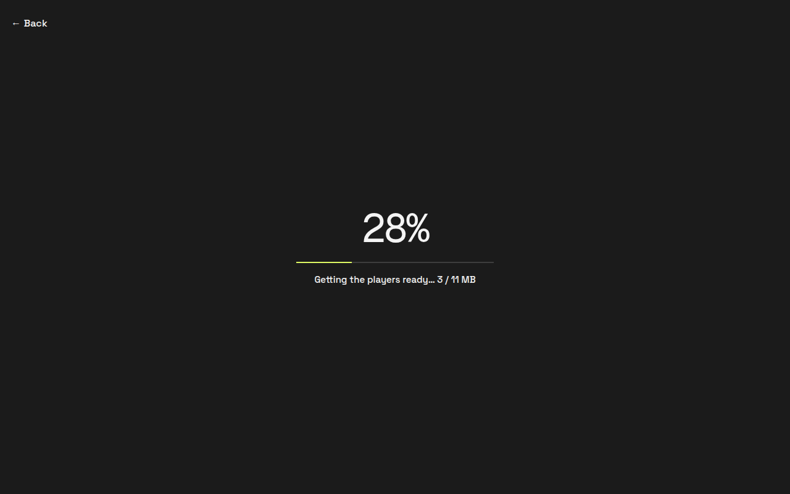
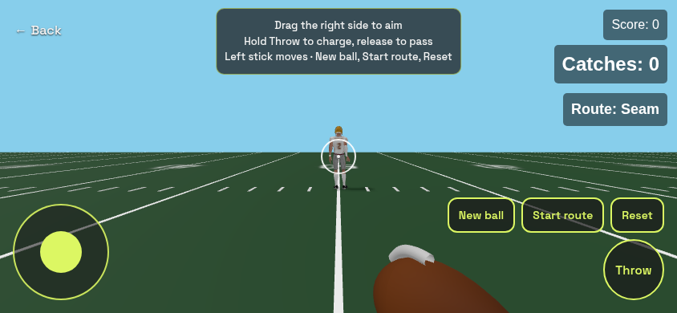
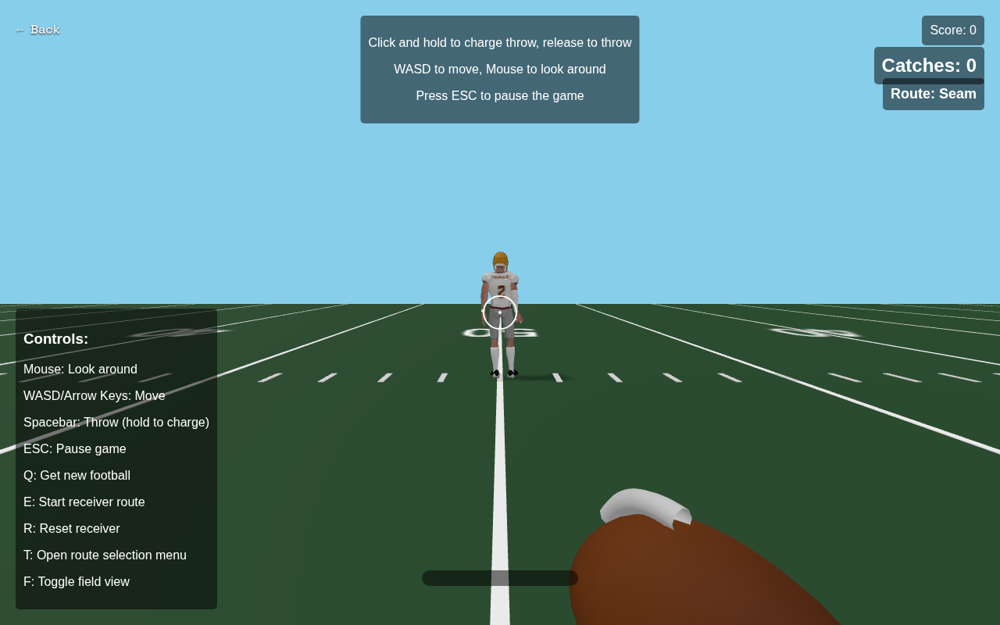

# QB Game - First Person Quarterback

A first-person quarterback game built with Three.js and Cannon.js physics engine.

## Screenshots







## Features

- First-person perspective quarterback gameplay
- Throw footballs to a receiver
- Physics-based ball movement
- Power meter for throw strength
- Phone touch controls
- A loading gate that waits until both player models have loaded

## Controls

### Desktop

- WASD: Move around the field
- Mouse: Look around
- Click and hold: Charge throw
- Release click: Throw the football

### Touch

- Drag the right side of the screen to aim
- Hold Throw to charge, then release to throw
- Left stick to move

Portrait shows a rotate-your-phone hint. New ball, Start route, and Reset sit above Throw.

## Development

This project uses Vite for development and bundling.

```bash
# Install dependencies
npm install

# Run development server
npm start
```

## Build

```bash
npm run build
```

The production base path is `/demos/qb-simulator/`. Draco-compressed player models live in `public/models/` and are copied into `dist/models/`.

## Technologies Used

- Three.js for 3D rendering
- Cannon.js for physics
- Vite for bundling and development server
