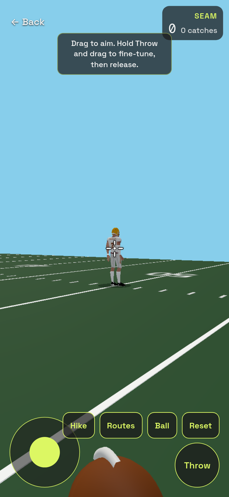

# QB Game - First Person Quarterback

A first-person quarterback game built with Three.js and Cannon.js physics engine.

## Screenshots




## Features

- First-person passes that go through the crosshair when you give them enough arm
- An offensive line that gets in a stance and pass-blocks or run-blocks. Offense only
- Six calls, plus a top-down play designer: drag four receivers and draw their routes
- Custom plays saved in this browser only
- Four downs. A catch or a run moves the chains. An incompletion stops the clock
- Stands drawn in code. Press F to hide them
- Mouse and touch, landscape and portrait

The plan for what comes next is in [docs/ROADMAP.md](docs/ROADMAP.md).

## Controls

### Desktop

- 1–6 select a play. P opens the playbook. D opens the play designer
- E hikes. WASD moves
- Hold the left mouse button or Space to throw after a pass play
- On Keeper or Handoff, move the ball carrier and press Space to end the run
- F toggles the stands. M mutes. Esc pauses

### Touch

Works in landscape and portrait.

- Plays, Draw, and Hike sit above Throw
- Drag anywhere to aim. Hold Throw and drag to keep aiming
- On a run, Throw becomes Down
- In Draw, drag a numbered dot to align that receiver, then draw his route with a finger. Undo, Clear, and Save are on the bar

## Play designer

Draw is a top-down field. Receivers snap to half-yard spots on or behind the line of scrimmage, outside the offensive line. A stroke is smoothed into a route the player can run. Save stores it in `localStorage` under `qb-custom-plays` and adds it to the playbook. Nothing is uploaded.

## Tests

```bash
npm test
```

Throw planning, catch scoring, and pocket movement are plain functions under `src/game/` with tests in `test/`.

## Development

This project uses Vite for development and bundling.

```bash
# Install dependencies
npm install

# Run development server
npm start
```

## Build

```bash
npm run build
```

The production base path is `/demos/qb-simulator/`. That is what the portfolio embed uses. Do not change it for a preview.

A standalone preview, served from the root of its own host:

```bash
VITE_BASE=/ npm run build
npm run preview
```

`VITE_BASE` must end in `/` when it is a directory (`VITE_BASE=/play/ npm run build`). The game does not fetch a model file. The field, the stands, the players, and the sounds are generated in code.

## Assets

The players, the offensive line, the stands, the ball, and the sounds are original code. No downloaded model is shipped.

The previous player files were added on 2025-03-25 by Mihai Lapuste (`add football palyer`, `add main player body`). Both GLBs carried Sketchfab export metadata:

- Title: American Football Player
- Author: blakeallen25 (https://sketchfab.com/blakeallen25)
- Source: https://sketchfab.com/3d-models/american-football-player-10bf41a1c05a4c9cb74676b7dd8cb18e
- License: [CC BY 4.0](http://creativecommons.org/licenses/by/4.0/)
- The receiver file’s generator was `Sketchfab-12.67.0`. The quarterback file had been re-exported with `gltfeditor.com` and later Draco-compressed.

Those binaries were about 3.5 MB and 6.9 MB, and the receiver alone was roughly 480,000 triangles. They are removed from this branch so a phone can draw four receivers and a line. The Sketchfab page still offers the model under CC BY 4.0 if you want the original mesh. This game does not redistribute it.

## Technologies Used

- Three.js for 3D rendering
- Cannon.js for physics
- Vite for bundling and development server
