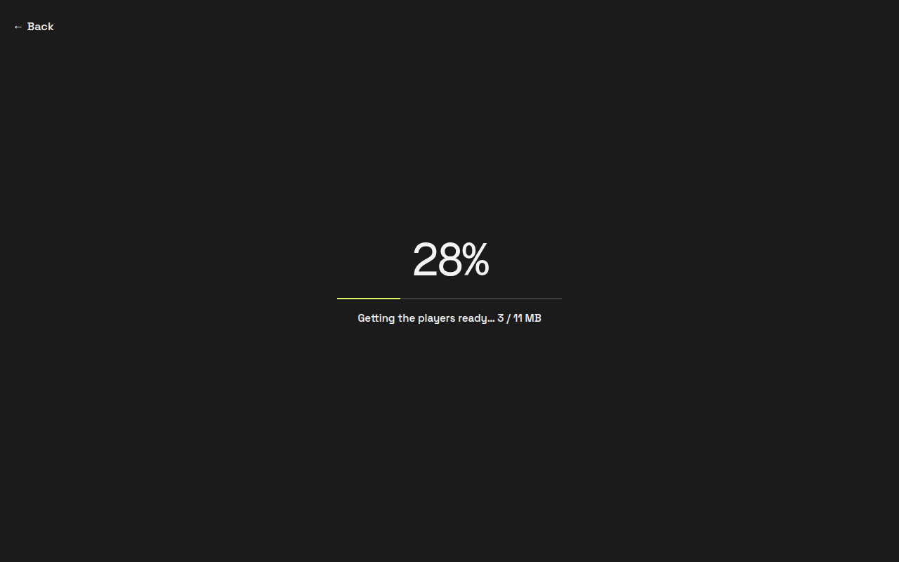
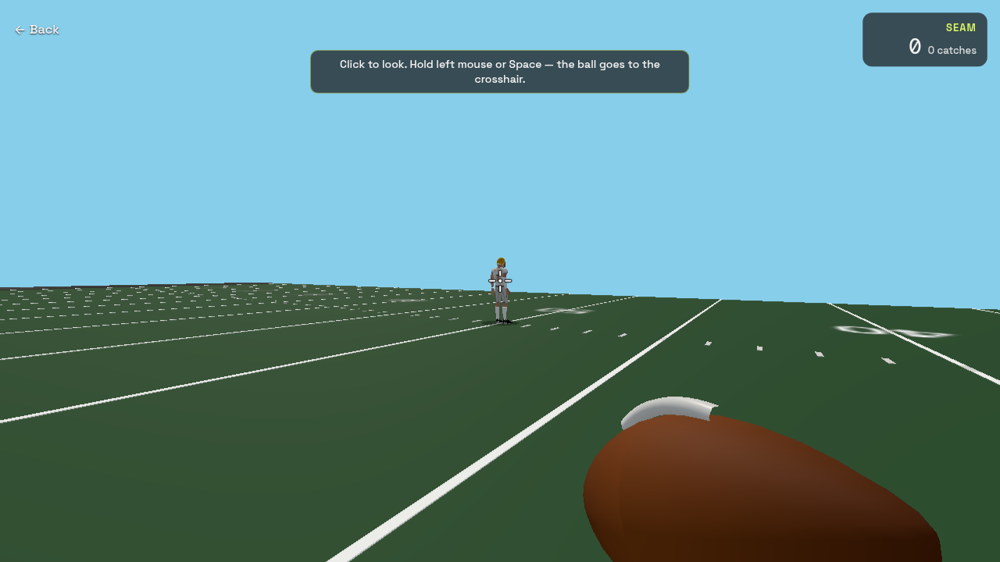
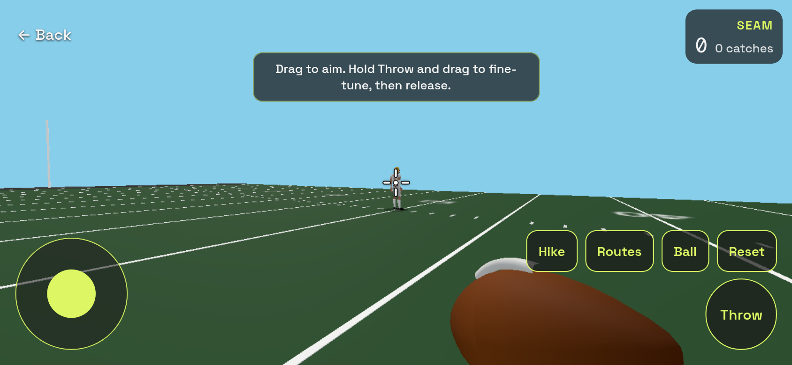

# QB Game - First Person Quarterback

A first-person quarterback game built with Three.js and Cannon.js physics engine.

## Screenshots








## Features

- First-person passes that go through the crosshair when you give them enough arm
- A charge arc, in lime when the pass can arrive and red when it dies short
- A receiver you hike into a route, and points for the catch
- Mouse and touch, landscape and portrait
- A loading gate that waits until both player models have loaded

The plan for what comes next is in [docs/ROADMAP.md](docs/ROADMAP.md).

## Controls

### Desktop

- Click the field to look. Mouse aims.
- Hold the left mouse button or Space, then release to throw
- WASD or arrow keys move in the pocket
- E hikes the receiver (back to the line, then the route). R resets him without hiking
- T, or 1 / 2 / 3, picks a route
- Q puts a ball back in your hand. F toggles the stadium view. M mutes. Esc pauses

### Touch

Works in landscape and portrait.

- Drag anywhere to aim
- Hold Throw and drag to keep aiming, then release to throw
- Left stick moves
- Hike, Routes, Ball, and Reset sit above Throw

## Tests

```bash
npm test
```

Throw planning, catch scoring, and pocket movement are plain functions under `src/game/` with tests in `test/`.

## Development

This project uses Vite for development and bundling.

```bash
# Install dependencies
npm install

# Run development server
npm start
```

## Build

```bash
npm run build
```

The production base path is `/demos/qb-simulator/`. That is what the portfolio embed uses. Do not change it for a preview.

A standalone preview, served from the root of its own host:

```bash
VITE_BASE=/ npm run build
npm run preview
```

`VITE_BASE` must end in `/` when it is a directory (`VITE_BASE=/play/ npm run build`). Draco-compressed player models live in `public/models/` and are copied into `dist/models/`.

## Assets

Milestone 1 adds no binary files. The ball, the field paint, the charge arc, and the catch sounds are generated in code. The two player GLBs and the Draco decoder were already in the repository. The decoder comes from Three.js examples (MIT). A license for the player models is not recorded in the source; they were not modified.

## Technologies Used

- Three.js for 3D rendering
- Cannon.js for physics
- Vite for bundling and development server
